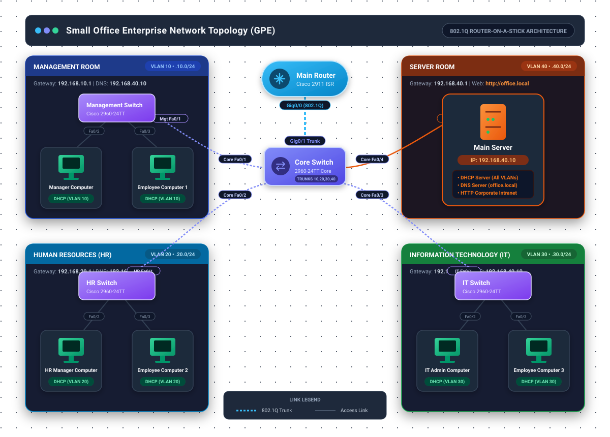
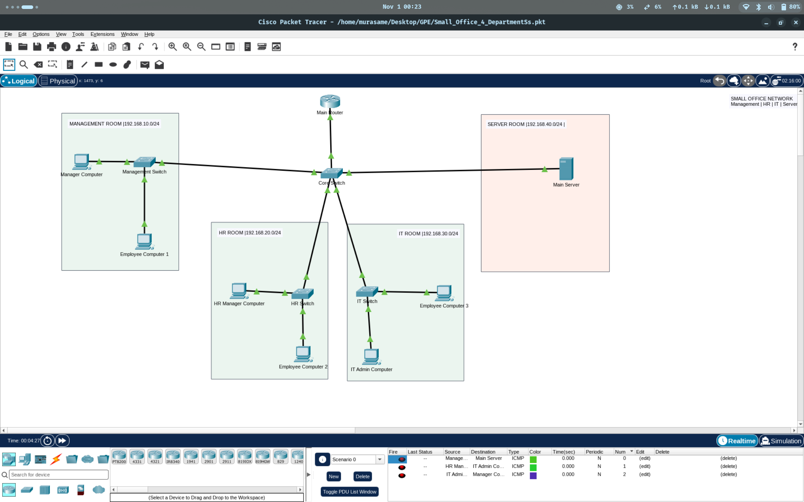
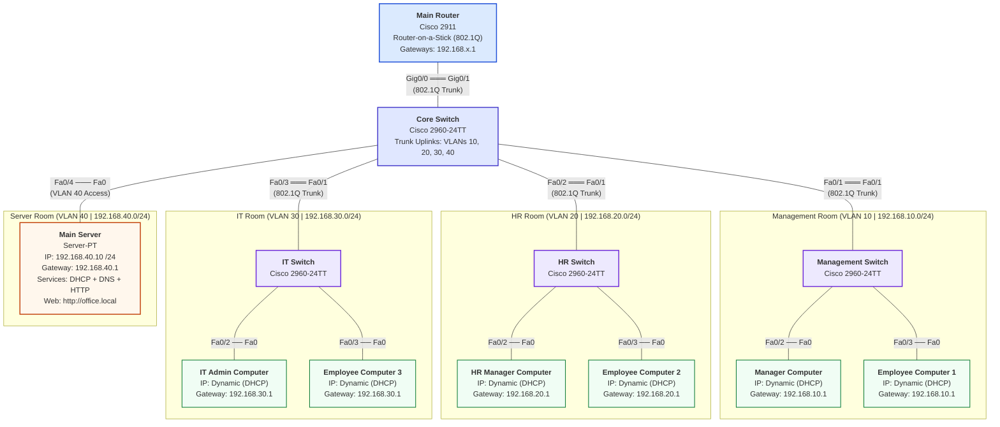

# Small Office Enterprise Network Simulation (GPE)

A 4-department enterprise network architecture designed and simulated in **Cisco Packet Tracer**. The network implements hierarchical switching, VLAN segmentation, Router-on-a-Stick (802.1Q) inter-VLAN routing, and centralized network infrastructure services (DHCP, DNS, and HTTP).

---

## Network Architecture Blueprint



---

## Cisco Packet Tracer Simulation View



---

## Logical Wiring & Port Topology



---

## Detailed Physical & Logical Port Wiring Table

| Uplink Source Device  | Source Port          | Destination Device      | Destination Port     | Link Mode |     Encapsulation / VLAN      |
| :-------------------- | :------------------- | :---------------------- | :------------------- | :-------: | :---------------------------: |
| **Main Router**       | `GigabitEthernet0/0` | **Core Switch**         | `GigabitEthernet0/1` |   Trunk   | 802.1Q (VLANs 10, 20, 30, 40) |
| **Core Switch**       | `FastEthernet0/1`    | **Management Switch**   | `FastEthernet0/1`    |   Trunk   | 802.1Q (VLANs 10, 20, 30, 40) |
| **Core Switch**       | `FastEthernet0/2`    | **HR Switch**           | `FastEthernet0/1`    |   Trunk   | 802.1Q (VLANs 10, 20, 30, 40) |
| **Core Switch**       | `FastEthernet0/3`    | **IT Switch**           | `FastEthernet0/1`    |   Trunk   | 802.1Q (VLANs 10, 20, 30, 40) |
| **Core Switch**       | `FastEthernet0/4`    | **Main Server**         | `FastEthernet0`      |  Access   |     VLAN 40 (Server Room)     |
| **Management Switch** | `FastEthernet0/2`    | **Manager Computer**    | `FastEthernet0`      |  Access   |     VLAN 10 (Management)      |
| **Management Switch** | `FastEthernet0/3`    | **Employee Computer 1** | `FastEthernet0`      |  Access   |     VLAN 10 (Management)      |
| **HR Switch**         | `FastEthernet0/2`    | **HR Manager Computer** | `FastEthernet0`      |  Access   |         VLAN 20 (HR)          |
| **HR Switch**         | `FastEthernet0/3`    | **Employee Computer 2** | `FastEthernet0`      |  Access   |         VLAN 20 (HR)          |
| **IT Switch**         | `FastEthernet0/2`    | **IT Admin Computer**   | `FastEthernet0`      |  Access   |         VLAN 30 (IT)          |
| **IT Switch**         | `FastEthernet0/3`    | **Employee Computer 3** | `FastEthernet0`      |  Access   |         VLAN 30 (IT)          |

---

## IP Addressing & VLAN Allocation

| Department / Zone   |  VLAN ID  |      Subnet       |   Gateway IP   |   DNS Server    |      IP Assignment       |
| :------------------ | :-------: | :---------------: | :------------: | :-------------: | :----------------------: |
| **Management**      | `VLAN 10` | `192.168.10.0/24` | `192.168.10.1` | `192.168.40.10` |      Dynamic (DHCP)      |
| **Human Resources** | `VLAN 20` | `192.168.20.0/24` | `192.168.20.1` | `192.168.40.10` |      Dynamic (DHCP)      |
| **IT Department**   | `VLAN 30` | `192.168.30.0/24` | `192.168.30.1` | `192.168.40.10` |      Dynamic (DHCP)      |
| **Server Room**     | `VLAN 40` | `192.168.40.0/24` | `192.168.40.1` | `192.168.40.10` | Static (`192.168.40.10`) |

---

## Device Role & Naming Directory

| Display Name            | Device Hardware | IOS Hostname        | Department / Zone | Role & Function                                 |
| :---------------------- | :-------------- | :------------------ | :---------------- | :---------------------------------------------- |
| **Main Router**         | Cisco 2911      | `Main-Router`       | Central Routing   | 802.1Q Inter-VLAN Gateway & DHCP Relay          |
| **Core Switch**         | Cisco 2960-24TT | `Core-Switch`       | Core Distribution | 802.1Q Trunk Aggregator for all VLANs           |
| **Management Switch**   | Cisco 2960-24TT | `Management-Switch` | Management Room   | Access switch for VLAN 10                       |
| **Manager Computer**    | PC-PT           | —                   | Management Room   | Management department lead workstation          |
| **Employee Computer 1** | PC-PT           | —                   | Management Room   | Management department staff workstation         |
| **HR Switch**           | Cisco 2960-24TT | `HR-Switch`         | HR Room           | Access switch for VLAN 20                       |
| **HR Manager Computer** | PC-PT           | —                   | HR Room           | Human Resources manager workstation             |
| **Employee Computer 2** | PC-PT           | —                   | HR Room           | Human Resources staff workstation               |
| **IT Switch**           | Cisco 2960-24TT | `IT-Switch`         | IT Room           | Access switch for VLAN 30                       |
| **IT Admin Computer**   | PC-PT           | —                   | IT Room           | IT Network & Systems Administrator PC           |
| **Employee Computer 3** | PC-PT           | —                   | IT Room           | IT Technical Support workstation                |
| **Main Server**         | Server-PT       | —                   | Server Room       | Hosts DHCP Pools, DNS, and Corporate Web Server |

---

## Core Network Services

### 1. Inter-VLAN Routing (Router-on-a-Stick)

Routing between departmental subnets is performed via subinterfaces on **Main Router** (`GigabitEthernet0/0`):

- `g0/0.10`: Encapsulation `dot1Q 10`, IP `192.168.10.1 255.255.255.0`
- `g0/0.20`: Encapsulation `dot1Q 20`, IP `192.168.20.1 255.255.255.0`
- `g0/0.30`: Encapsulation `dot1Q 30`, IP `192.168.30.1 255.255.255.0`
- `g0/0.40`: Encapsulation `dot1Q 40`, IP `192.168.40.1 255.255.255.0`

### 2. DHCP Relay (`ip helper-address`)

Since the DHCP server resides on VLAN 40 (`192.168.40.10`), each router subinterface is configured with:

```ios
ip helper-address 192.168.40.10
```

This forwards client broadcast DHCP Discover packets as unicast packets to the central server.

### 3. DNS & Intranet Web Service

- **DNS Server**: Mapped domain `office.local` $\rightarrow$ `192.168.40.10`.
- **HTTP Web Server**: Active on port 80 serving the corporate intranet homepage. Any PC can test connectivity by browsing to `http://office.local` or `http://192.168.40.10`.

---

## Workspace Files

- [`network_diagram.svg`](network_diagram.svg) — Vector architecture blueprint with port-level wiring and departmental zoning.
- [`Small_Office_4_DepartmentSs.pkt`](Small_Office_4_DepartmentSs.pkt) — Active Cisco Packet Tracer project file with simplified names and synchronized IOS configurations.
- [`Screenshot.png`](Screenshot.png) — Visual snapshot of the network layout and simulation canvas.
- [`son.png`](son.png) — Visual reference template for simplified device naming and layout.
